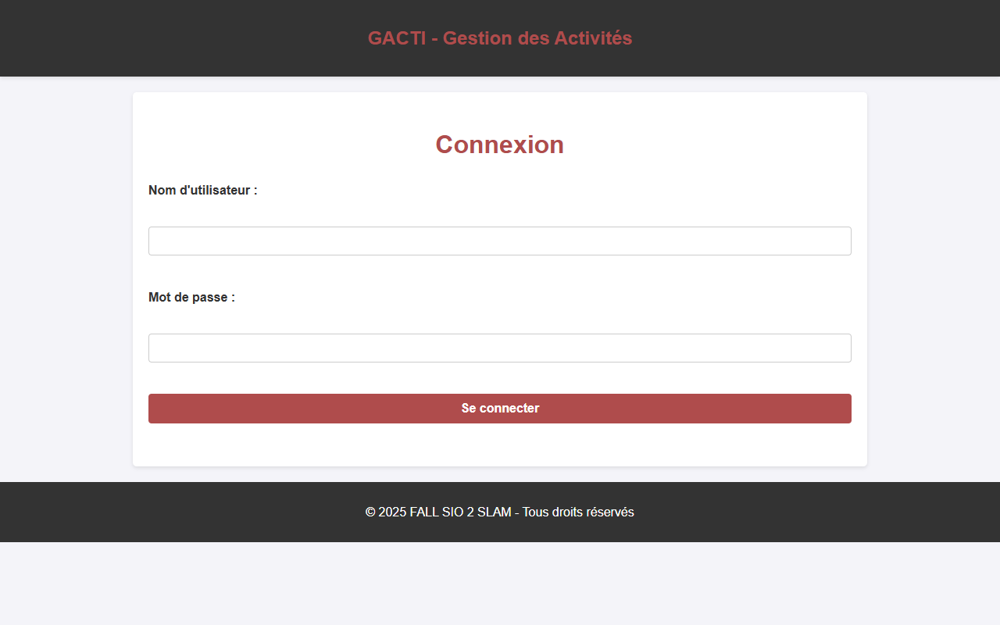
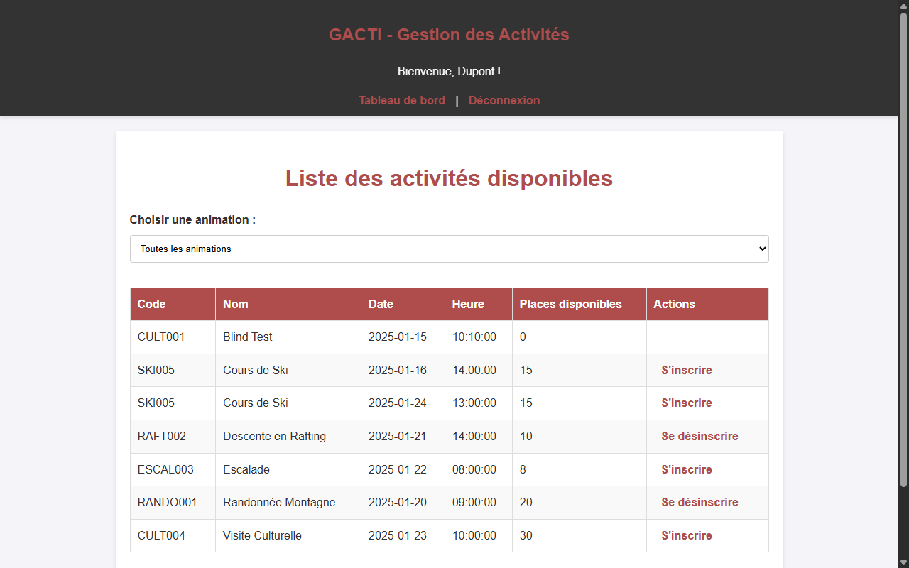
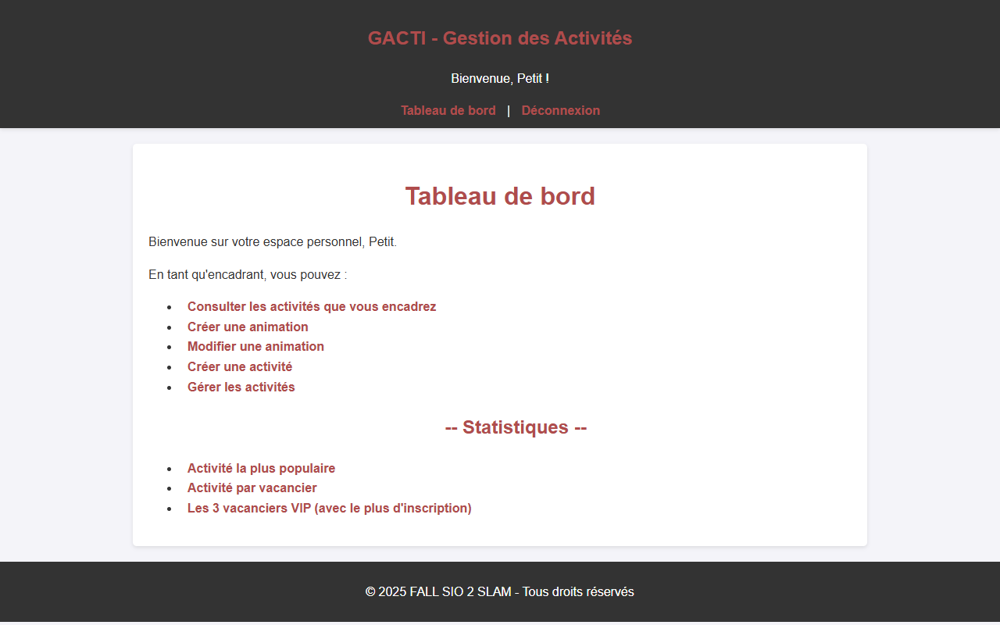
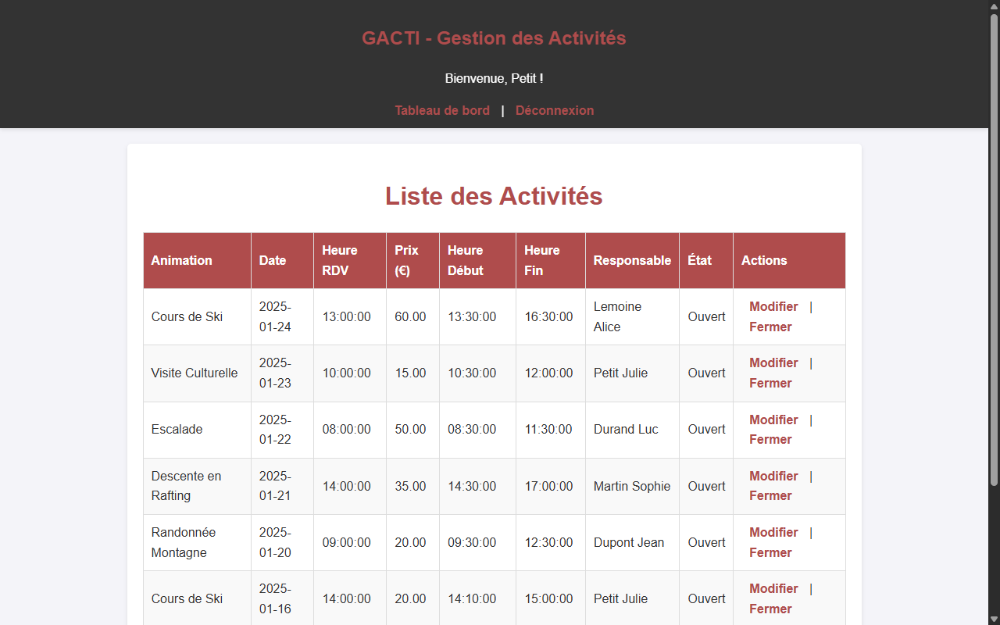
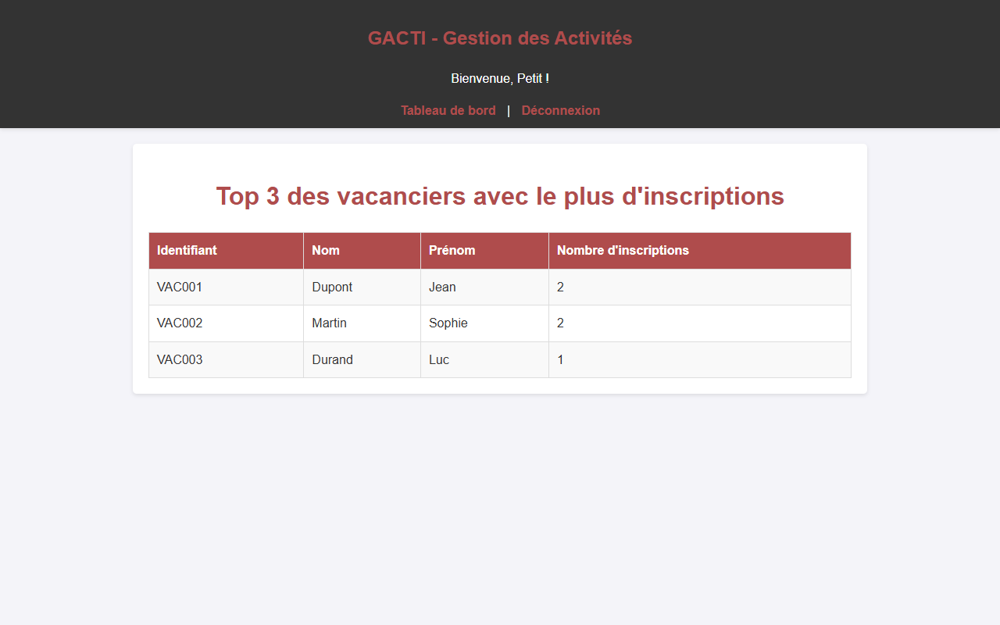

# VVA — Gestion des animations d'un village vacances

Application web réalisée pendant mon **BTS SIO option SLAM** (2024–2025), projet GACTI.

Dans un village vacances, les **encadrants** créent des animations (ski, rafting, escalade…) et leurs
séances (activités). Les **vacanciers** consultent les activités et s'inscrivent selon les places
disponibles. Chaque type de compte a ses propres droits.

## Captures

| Connexion | Activités (vacancier) |
|---|---|
|  |  |

| Tableau de bord (encadrant) | Gestion des activités | Statistiques |
|---|---|---|
|  |  |  |

## Fonctionnalités

- Inscription et connexion (mots de passe stockés avec `password_hash`).
- **Vacancier** : liste des activités (filtre par animation), inscription / désinscription, mes activités.
- **Encadrant** : créer et modifier des animations et des activités, annuler une activité, voir les
  inscrits, statistiques (activité la plus populaire, activités par vacancier, 3 vacanciers les plus inscrits).
- Accès aux pages contrôlé selon le type de compte.

## Technologies

PHP 8 (PDO, requêtes préparées), MySQL 8, HTML, CSS.

## Installation

Prérequis : PHP 8 et MySQL (par exemple avec AMPPS, XAMPP ou WAMP).

1. Créer la base avec les données d'exemple :
   ```bash
   mysql -u root -p < database/vva.sql
   ```
   (ou onglet **Importer** de phpMyAdmin). Le script crée la base `vva`.
2. Copier `.env.example` en `.env` et y mettre les identifiants MySQL.
3. Lancer le site :
   ```bash
   php -S localhost:8000
   ```
   puis ouvrir http://localhost:8000.

Les noms de tables sont écrits en majuscules dans certaines requêtes : sous Linux, MySQL doit avoir
`lower_case_table_names=1` (c'est le cas par défaut sous Windows).

## Comptes de démonstration

Mot de passe pour tous : `demo1234`

| Identifiant | Rôle |
|---|---|
| `ENC001`, `ENC002` | Encadrant |
| `VAC001`, `VAC002`, `VAC003` | Vacancier |

## Auteur

Mohamed FALL — [portfolio](https://mohafall.github.io) · [GitHub](https://github.com/MohaFall)
